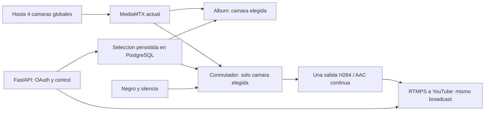

# YouTube Live opcional: propuesta previa a incorporar procesamiento

Fecha: 17/11/2026. Estado: evaluacion y diseno; NO es una grabacion implementada.

## Decision solicitada

El administrador necesita poder cerrar la pantalla sin terminar la grabacion.
Por eso se descarta depender de un navegador u OBS en su computadora. Para
obtener una salida continua con camaras WebRTC heterogeneas se propone un unico
conmutador y codificador en el servidor, aislado y limitado. La condicion del
pedido original exige explicar este costo antes de incorporarlo: este documento
es esa propuesta. No se agrego el proceso a Docker Compose de produccion.

El esquema actual distribuye cada camara por separado. El tilde selecciona
una invitacion en `TransmisionEvento`; los navegadores del album abren otra
conexion al cambiarla. No existe una senal audiovisual continua del evento.
`conectarMedia` tampoco fija un codec: VP8/Opus es una combinacion posible.
MediaMTX distribuye medios pero no los convierte automaticamente al formato
de YouTube. Reiniciar un FFmpeg por camara no acredita continuidad de archivo.

## Arquitectura propuesta

- El tilde del album es la unica fuente de seleccion. El worker no tiene otra
  lista de prioridades ni decide a que invitado emitir.
- Solo se conecta y decodifica la camara seleccionada. No se mezclan ni se
  graban las cuatro. Las vistas previas actuales siguen en los navegadores.
- Una tuberia GStreamer mantiene reloj, encoder, muxer y conexion RTMPS.
  `input-selector` antes del encoder permite reemplazar la entrada; nunca se
  reinicia el encoder al cambiar de invitado. El nuevo bin se limita a una
  entrada; el anterior se desconecta y libera. No usar `compositor` de 4 videos.
- Negro y silencio son el fallback persistente: al quitar el tilde, desconectarse
  la camara o cambiar de fuente, se corta inmediatamente el audio anterior y se
  emiten frames negros y silencio hasta que exista la fuente elegida y validada.
  No se mantiene el ultimo audio ni se sustituye por otra camara.
- En una conmutacion pueden existir breves segundos de negro esperando el nuevo
  keyframe. Se prioriza privacidad y estabilidad por encima de un corte invisible.
- Una desconexion de YouTube reintenta la misma emision, no crea otra. No existe
  cola de recuperacion: lo que no llega a YouTube durante la caida se pierde.
  Un reinicio del VPS tampoco garantiza continuidad de archivo en YouTube.
- El proceso corre independiente del navegador; cerrar la pantalla del
  administrador no altera su estado deseado en PostgreSQL.

## Recursos: limites propuestos para 2 vCPU / 3,81 GiB

| Elemento | Limite inicial propuesto |
|---|---|
| Camaras activas o reservadas | 4 en TODO el servidor, ya ajustado en el codigo local |
| Grabaciones YouTube | 1 en TODO el servidor |
| Salida | 960x540, 20 fps, H264 ultrafast y AAC 96 kbps |
| Bitrate de video | 1,2 Mbps, sin variar el perfil durante la emision |
| CPU del contenedor de grabacion | 0,60 de un nucleo, como maximo 30% de las 2 vCPU |
| Memoria | 384 MiB, sin swap; colas acotadas a unos pocos frames |
| Procesos | pids limitados; un solo encoder de video y uno de audio |
| Disco de grabacion | Ninguno; filesystem read-only, frames y colas en RAM |
| Trafico adicional de YouTube | ~1,30 Mbps antes de protocolos; presupuestar 1,5 Mbps |

El limite CPU es un techo, no una promesa de tiempo real: si el trabajo no cabe
en esa cuota, se debe rechazar la grabacion o bajar el perfil despues de una
prueba previa, nunca ampliar automaticamente la cuota. Durante una grabacion
no cambiar resolucion/codec para intentar salvar carga; pasar a negro/silencio
y detener solo la grabacion si persiste la degradacion. Un OOM termina el
worker aislado, sin reiniciar FastAPI, PostgreSQL ni MediaMTX.

Los 61 Mbps medidos de subida no son presupuesto libre ni garantizado. Hay que
restar albums, previews, protocolos y otros servicios. Las 4 previews mas un
album remoto y YouTube pueden rondar 7,5 Mbps antes de variaciones y margen.
Cada espectador adicional del album agrega aproximadamente otro bitrate de
camara. No hay pago a un servicio de video adicional; la transferencia del
proveedor del VPS sigue sujeta a su plan.

La prueba `infra/youtube-evaluacion` evalua solo decode VP8/Opus y encode
H264/AAC con patrones sinteticos, en Docker LOCAL y sin red. No prueba el
conmutador, la red celular, OAuth, YouTube ni el hardware del VPS. Sus resultados
no habilitan por si solos produccion. La fixture comprimida y la salida FLV se
mantienen en RAM/pipe y se descartan; no se escribe video en disco.

Resultado local inicial (20 segundos por escenario, cuota 0,60 CPU / 384 MiB):

| Escenario | CPU de un nucleo local | RAM del contenedor | Video/tiempo real |
|---|---:|---:|---:|
| Negro/silencio 540p20 | 6,5% | 48,2 MiB | 1,011x |
| VP8/Opus 720p24 a H264/AAC 540p20 | 15,1% | 54,1 MiB | 1,017x |
| VP8/Opus 720p24 a H264/AAC 720p20 | 14,0% | 58,7 MiB | 1,017x |

[Resultados y comandos reproducibles](youtube-live-medicion-local.json).
Las cifras NO son consumo del VPS ni incluyen el worker GStreamer completo,
el conmutador o RTMPS; no extrapolar el porcentaje al procesador del VPS.
Antes de activar se requiere un ensayo sostenido de al menos 30 minutos,
con 4 camaras, cambios/revocaciones y la carga normal de EVENTOS, verificando
que la salida mantiene tiempo real dentro de su cuota y no afecta el resto.

### Evitar conversion cuando sea posible

Para una senal ya continua H264/AAC compatible, el reenvio debe copiar los
paquetes sin recodificar. Esa entrada no existe en el sistema actual. Que una
camara negocie H264 no basta: audio Opus, perfiles, resoluciones, relojes y
keyframes independientes impiden asumir conmutacion segura por simple copia.
No activar un camino de copia entre camaras hasta demostrarlo con dispositivos
reales y mantener monotonia de timestamps y una unica conexion RTMPS.
La primera version propuesta usa un solo encoder normalizado, no cuatro.

## Autorizacion de cuentas y privacidad

- Configuracion por evento apagada por defecto. Con ella apagada no hay worker,
  broadcast nuevo ni trafico audiovisual hacia YouTube.
- Solamente propietario, superadministrador o ADMIN_EVENTO/PROPIETARIO activo
  seleccionan el destino, habilitan grabacion, inician y detienen. Un permiso
  de edicion de invitados no basta.
- Cada usuario autoriza su PROPIO canal. Un agasajado debe estar asignado al
  evento y tener una sesion Google verificada. El administrador puede seleccionar
  su conexion o una conexion voluntariamente aportada por un agasajado vigente;
  no puede iniciar OAuth en nombre de otro usuario.
- Flujo Authorization Code de Google, `state` aleatorio de un solo uso con
  expiracion, PKCE S256 y cliente confidencial. Callback exclusivo del backend;
  codigo canjeado en backend y redireccion al frontend sin codigo ni tokens.
  Vincular solicitud y callback con cookie Secure/HttpOnly/SameSite=Lax y nonce.
- Comprobar identidad Google del autorizante contra la sesion de EVENTOS y
  obtener su canal mediante `channels.list(mine=true)`. Si Google ofrece una
  cuenta de marca, registrar el channel ID realmente autorizado. Nunca aceptar
  como acreditacion un correo o channel ID enviados libremente por el frontend.
- Para crear/bind/transition, las API oficiales admiten `youtube` o
  `youtube.force-ssl`; se propone solicitar solo `youtube.force-ssl`, ademas de
  identidad `openid email` si se necesita para vincular el consentimiento.
  **Google no ofrece para estas operaciones un scope limitado a este evento.**
  El permiso de YouTube es mas amplio que grabar un evento: esto debe explicarse
  en la pantalla de consentimiento; EVENTOS limitara sus llamadas a canales y
  emisiones necesarias. No pedir Gmail, Drive, contactos ni contrasenas.
- Refresh/access tokens y clave RTMPS cifrados con una clave dedicada del
  backend, fuera de la base y del repositorio. Rotacion y renovacion bajo lock.
  Ni respuestas API, logs, auditorias, URLs del frontend ni excepciones incluyen
  estos secretos. El worker recibe la clave en memoria por canal privado; no
  pasarla en argumentos de proceso ni imprimirla con stderr de GStreamer.
- El agasajado puede revocar su aporte; termina exclusivamente la salida YouTube
  que lo usa. El administrador puede quitar el canal del evento, pero no operar
  otras conexiones ni revocar globalmente una cuenta ajena. Distinguir quitar
  una autorizacion de evento de revocar la concesion completa en Google.
- Privacidad inicial `unlisted`; opciones `private`, `unlisted`, `public`.
  Publico exige accion y confirmacion explicita. No degradar de privado/no
  listado a publico ante un error. Leer la privacidad efectiva de YouTube y
  mostrarla; si no coincide con la elegida, detener antes de enviar medios.
- El canal puede requerir habilitar Live, con espera inicial de hasta 24 horas.
  Ante `liveStreamingNotEnabled`, indicar que lo habilite en YouTube Studio y
  mantener intactos album y camaras. Otros errores de permisos no se etiquetan
  automaticamente como Live deshabilitado.

## Modelo y endpoints previstos (todavia no implementados)

Una migracion aditiva sera necesaria para persistir autorizaciones y ejecuciones:

1. `youtube_conexiones`: propietario de la concesion, evento, channel ID/titulo,
   tokens cifrados, scopes, expiracion, estado de conexion y revocacion.
2. `youtube_config_evento`: habilitada=false, conexion seleccionada, privacidad
   unlisted, version de configuracion.
3. `youtube_grabaciones`: evento, conexion y privacidad fijadas al iniciar,
   broadcast/stream IDs, clave RTMPS cifrada, estado deseado y observado,
   inicio/fin, motivo de error sanitizado y heartbeat del worker.
4. `youtube_oauth_intentos`: hash de state y vinculo de sesion, PKCE cifrado,
   usuario/evento y expiracion/uso. Purgado de intentos vencidos.

Estas tablas almacenan metadatos y credenciales cifradas, nunca multimedia.
El cambio de seleccion de camara reutiliza el registro existente; no necesita
una nueva tabla de video por invitado ni modifica invitaciones/QR/fotos/ingresos.

API orientativa bajo `/eventos/{slug}/youtube`: estado, configuracion,
conexion propia/iniciar OAuth, callback servidor, desconectar aporte propio,
iniciar grabacion y detener. El backend decide quien puede cada accion; no
confiar en botones ocultos del frontend.

El panel mostrara selector de aportante/canal, conectado/desconectado/error,
habilitacion opcional, privacidad y fecha/hora de inicio en zona del usuario.
Estados separados: desactivada, lista, iniciando, emitiendo, reconectando,
deteniendo, finalizada, archivando, archivo_disponible, error.
Mostrar enlace de emision cuando exista el ID y enlace al archivo cuando
YouTube confirme disponibilidad; no afirmar archivo guardado por tener un URL.

## Ciclo de vida y fallas

- Reservar una sola plaza global bajo lock PostgreSQL antes de crear recursos.
  Una orden duplicada o doble clic no crea dos broadcasts. Reconciliar IDs y
  estado antes de reintentar una llamada de resultado incierto.
- Crear un `liveStream` y un `liveBroadcast`, fijar privacidad y enlazarlos.
  Para 540p20 usar resolucion/frameRate `variable` en la API, no declarar 720p30.
  Obtener `rtmpsIngestionAddress` desde Google y validar host/puerto y TLS.
  Iniciar la unica tuberia y transicionar a live solo con stream activo.
- No permitir que una URL arbitraria se convierta en destino del worker.
  Fuente de MediaMTX privada y autenticada, limitada al evento, a la camara
  seleccionada y al worker. No abrir RTSP, RTMP ni la API admin al exterior.
  El protocolo interno y las credenciales de servicio deben probarse aparte:
  hoy MediaMTX solo tiene WebRTC habilitado.
- No crear un broadcast nuevo al cambiar el tilde ni al reconectar RTMPS.
  Mantener `enableAutoStop=false`; no prometer que YouTube preservara una
  emision tras una caida prolongada. Si ya esta complete, exigir otro inicio
  explicito y avisar que sera otro video.
- Detener/deshabilitar/revocar: persistir el deseo de parar; cesar envio, liberar
  el encoder y completar solo el broadcast creado por EVENTOS. Si Google no
  responde, mostrar finalizacion pendiente y reintentar sin seguir enviando
  video. No detener camaras, cambiar el tilde ni tocar el album.
- Cierre del navegador: sin efecto. Caida del worker: watchdog con backoff y
  mismo broadcast; respetar que el administrador haya detenido o revocado.
- Sin disco, los segmentos perdidos no son recuperables. YouTube puede archivar
  automaticamente emisiones de menos de 12 horas; no se garantiza archivo para
  emisiones mayores. Propuesta: maximo 11h30 por sesion con aviso previo y
  finalizacion controlada. No partir automaticamente en videos diferentes.

## Verificacion requerida antes de darlo por terminado

| Caso del pedido | Validacion prevista / situacion actual |
|---|---|
| Sin grabacion | Prueba que no hay procesos ni llamadas de ingest; camaras/album actuales |
| Canal administrador | OAuth real con canal de prueba; emision privada/no listada y archivo final |
| Canal agasajado | Dos usuarios, consentimiento del aportante y seleccion por admin |
| Cambio camara | Camaras con patrones/audio distintos, mismo broadcast y RTMPS; revisar archivo final |
| Sin seleccion | Negro y silencio; ninguna otra camara ni audio anterior |
| Parar sin afectar album | Album y publicadores siguen conectados con sus IDs |
| Revocacion | Denegar nuevas ordenes y cortar worker; ningun token sale al navegador |
| Falla YouTube | DNS/TLS/red/401/403/429/5xx, backoff, tope de colas y sin bloqueo de FastAPI |
| CPU/RAM/red | Ensayo local preliminar; pendiente carga real en VPS dentro de cuotas |
| Cierre admin | Worker continua, cambio por otro admin y parada posterior |
| Limite global 4 | Prueba concurrente con 5 eventos: solo 4 reservas aceptadas |

No hay credenciales OAuth configuradas ni consentimiento real de canales en
esta evaluacion. Los casos de YouTube no se presentan como aprobados. Antes de
activar en produccion hacen falta cliente OAuth, redirect URI, API YouTube
habilitada, consentimiento/verificacion de la aplicacion cuando Google lo exija
y un canal de pruebas con Live habilitado. No se contrata un servicio pago.

## Fuentes oficiales consultadas

- [YouTube: RTMPS](https://developers.google.com/youtube/data/live/guides/rtmps-ingestion)
- [Crear liveBroadcast y scopes](https://developers.google.com/youtube/data/live/reference/rest/v3/liveBroadcasts/insert)
- [Crear liveStream](https://developers.google.com/youtube/data/live/reference/rest/v3/liveStreams/insert)
- [Transiciones de la emision](https://developers.google.com/youtube/data/live/reference/rest/v3/liveBroadcasts/transition)
- [OAuth de servidor](https://developers.google.com/identity/protocols/oauth2/web-server)
- [Formatos del codificador](https://support.google.com/youtube/answer/2853702)
- [Archivo en YouTube y duracion](https://support.google.com/youtube/answer/6247592?hl=es)
- [Habilitar Live](https://support.google.com/youtube/answer/2907883)
- [Selector GStreamer](https://gstreamer.freedesktop.org/documentation/coreelements/input-selector.html)
- [Encoder H264](https://gstreamer.freedesktop.org/documentation/x264/index.html)
- [Limites Docker](https://docs.docker.com/engine/containers/resource_constraints/)
